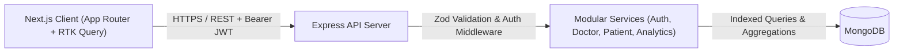

# Doctor Tracker — Clinical Administration Portal (Client)

## Description

Doctor Tracker is a secure, full-stack administrative web application designed to help healthcare coordinators manage doctors, their assigned patients, and clinical workload analytics from a single unified portal. Built with a decoupled **Next.js 15 (App Router)** frontend and a **Node.js / Express / MongoDB** RESTful backend, it delivers fast server-side pagination, debounced search and multi-criteria filtering, Bearer-token JWT authentication, a modern animated landing & contact experience, and interactive **Recharts** visualizations backed by MongoDB aggregation pipelines.

---

## Live Deployment & Demo Credentials

- **Backend API (Render)**: `https://server-doctor-tracker.onrender.com/api/v1`
- **Frontend (Vercel)**: Deployed via Vercel with `NEXT_PUBLIC_API_URL` connected to the Render API
- **Seeded Admin Login**: `admin@dt.com` / `Admin@123`

---

## Setup Guide

### Prerequisites

- **Node.js** v20+ (tested on v22.14.0)
- **MongoDB** (local instance or MongoDB Atlas connection string)
- **npm** v10+

### 1. Configure Environment Variables

Copy the provided `.env.example` files in both `Server-Care-Guide/` and `Client-Care-Guide/`:

```bash
# Backend environment (in Server-Care-Guide)
cp .env.example .env

# Frontend environment (in Client-Care-Guide)
cp .env.example .env.local
```

**`Server-Care-Guide/.env.example`**

```env
PORT=5000
NODE_ENV=development
MONGODB_URI=mongodb://localhost:27017/doctor_tracker
JWT_SECRET=change_this_to_a_long_random_secret_key
JWT_EXPIRES_IN=7d
CLIENT_URL=http://localhost:3000
```

**`Client-Care-Guide/.env.example`**

```env
NEXT_PUBLIC_API_URL=http://localhost:5000/api/v1
```

### 2. Install Dependencies & Seed the Database

```bash
# In Server-Care-Guide
npm install
npm run seed
npm run dev
```

In a second terminal:

```bash
# In Client-Care-Guide
npm install
npm run dev
```

### 3. Access the Application

- **Frontend Portal**: `http://localhost:3000`
- **Backend API**: `http://localhost:5000/api/v1`
- **Seeded Admin Login**: `admin@dt.com` / `Admin@123`

---

## Key Frontend Features

- **Public Landing & Contact Pages**: Responsive, animated landing page (`#specialisations`, `#about`, `#pricing`, `#faq`) with transparent-to-frosted scroll-spy navbar, light-variant footer, and dedicated `/contact` page.
- **Protected Admin Portal**: Authenticated `/dashboard`, `/doctors`, `/doctors/[id]`, and `/patients` routes with collapsible sidebar (`AppShell`), breadcrumb topbar, and sign-out confirmation.
- **Shared UI Primitives**: Reusable `PageHeader`, `FilterBar` (search + toggleable filter popover/panel), `CustomSelect`, `DatePicker`, `DataTable`, `Pagination`, `Modal`, and `ConfirmDialog`.
- **Analytics & Charts**: Recharts area, bar, and donut visualizations for registration trends, patients per doctor, and patient condition distribution.

---

## System Architecture

Doctor Tracker follows a decoupled client-server architecture communicating over RESTful JSON endpoints (`/api/v1/*`) secured by JWT Bearer tokens:



1. **Client (`Client-Care-Guide/`)**: Next.js App Router pages compose reusable shared primitives. Redux Toolkit + RTK Query manages normalized API caching and automatic tag invalidation (`Doctor`, `Patient`, `Analytics`).
2. **Server (`Server-Care-Guide/`)**: Express exposes modular routes under `/api/v1` (`auth`, `doctors`, `patients`, `analytics`). Requests pass through `helmet`, `cors`, `authenticate` (Bearer JWT verification), and `validate` (Zod schemas) before reaching service-layer Mongoose queries.
3. **Database (MongoDB)**: Compound indexes on `specialization + createdAt`, `hospital + createdAt`, `doctorId + createdAt`, and `condition + createdAt` accelerate paginated filtering and aggregation pipelines.

---

## Technical Decisions

### 1. Why Redux Toolkit + RTK Query over Context API / Manual `useEffect` Fetching

- **Normalized Cache & Tag Invalidation**: Creating, updating, or deleting a patient automatically invalidates `Patient`, `Doctor`, and `Analytics` cache tags in `patientsApi.ts`, keeping doctor patient counts and dashboard charts synchronized without manual `refetch()` chains or prop drilling.
- **Built-in Request Lifecycle**: RTK Query provides `isLoading` (initial skeleton state), `isFetching` (background page/filter transition), and `isError` states out of the box, which map directly to our shared `DataTable`, `LoadingSkeleton`, and `ErrorState` components.

### 2. Why MongoDB Aggregation Pipelines + Compound Indexing for Analytics & Lists

- **Single-Pass Workload Aggregation**: Rather than loading all doctors and patients into Node.js memory to count relationships, `analytics.service.ts` uses `$lookup` + `$group` + `$dateToString` pipelines so MongoDB computes `patientsPerDoctor`, `conditionDistribution`, and `dateStats` in parallel.
- **Optimized List Queries**: Both `doctor.service.ts` and `patient.service.ts` run `.find().lean()` and `.countDocuments()` concurrently via `Promise.all()`, backed by compound indexes on filter + sort fields (`createdAt: -1`).

---

## Visual Evidence

> Capture and place Desktop (`1440x900`) and Mobile (`390x844`) screenshots after running `npm run seed` and starting both servers:

| View                                 | Desktop                                  | Mobile                                  |
| :----------------------------------- | :--------------------------------------- | :-------------------------------------- |
| **Landing & Contact**                | `docs/screenshots/landing-desktop.png`   | `docs/screenshots/landing-mobile.png`   |
| **Dashboard (Analytics & Recharts)** | `docs/screenshots/dashboard-desktop.png` | `docs/screenshots/dashboard-mobile.png` |
| **Doctors Management**               | `docs/screenshots/doctors-desktop.png`   | `docs/screenshots/doctors-mobile.png`   |
| **Patients Management**              | `docs/screenshots/patients-desktop.png`  | `docs/screenshots/patients-mobile.png`  |
